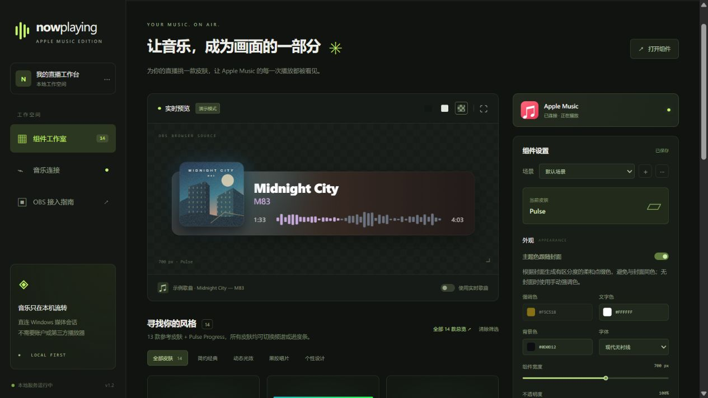
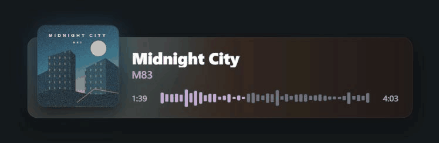
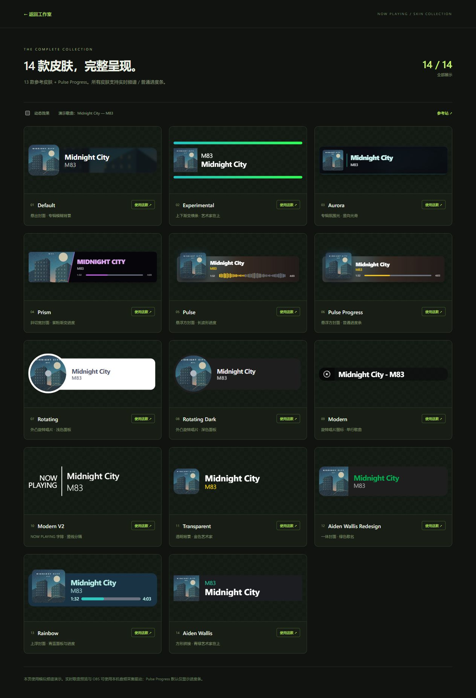

# Now Playing

Customizable now-playing overlays for OBS, running locally on Windows.

Currently supports the **official Apple Music desktop app**. No extra music player, browser extension, developer key, or additional account required.

[简体中文](README.md) · **English**



## Features

- **14 skins** — minimal cards, transparent layouts, rotating records, ambient artwork, and more.
- **Real audio spectrum or a progress bar** on every skin, with separate played and remaining colors.
- **Cover-derived accents** that stay distinct from the artwork, plus customizable colors, fonts, sizes, and component visibility.
- **Quick title transitions** — a short, blurred slide when the song changes, with scrolling for long titles.
- **Independent OBS scenes** with stable URLs, automatic saving, and configuration import/export.
- **Local operation** — song data and audio analysis stay on your computer.

## Preview



<details>
<summary><strong>Explore all 14 skins</strong></summary>



Default · Experimental · Aurora · Prism · Pulse · Pulse Progress · Rotating · Rotating Dark · Modern · Modern V2 · Transparent · Aiden Wallis Redesign · Rainbow · Aiden Wallis

</details>

Previews use demo content; live mode follows captured audio.

## Get started

### Requirements

- Windows with the official Apple Music app installed; **Windows 11 is recommended**.
- **Node.js 18+** and OBS Studio on the same computer.
- Windows build **20348+** for Apple Music process audio capture. System-output capture is also available.

### Run

Download this repository or clone it, then start the local server:

```powershell
git clone https://github.com/modcrafts/now-playing.git
cd now-playing
node server.mjs
```

You can also double-click **`start.cmd`**. There are no npm dependencies to install.

### Add to OBS

1. Play a song in Apple Music and open [the dashboard](http://127.0.0.1:3963).
2. Choose a skin and adjust its appearance. The dashboard interface is currently in Simplified Chinese.
3. Click **复制 OBS 组件链接** (Copy OBS overlay URL).
4. In OBS, add a **Browser Source**, paste the URL, and use the width and height shown in the dashboard.

Keep the server running while streaming. The dashboard tab can be closed. Press `Ctrl+C` in the server window to stop.

> The overlay provides visuals. Capture the music separately with an OBS audio source.

## Customize

| Setting | What it does |
| --- | --- |
| Display mode | Choose skin default, real audio spectrum, progress bar, or off. |
| Spectrum smoothing | Soften abrupt bar movements; switch it off to compare the direct response. |
| Cover-derived accent | Generate a softer contrasting accent from the current cover. |
| Audio source | Capture Apple Music only, all sound on the default output, or nothing. |
| Scene profiles | Save separate designs and browser-source URLs for different OBS scenes. |
| Motion | Enable or disable animations, including title changes. |

Open [the skin gallery](http://127.0.0.1:3963/skins.html) to compare every design. Your settings are saved locally.

## Troubleshooting

- **No song information:** start playback in the official Apple Music app, then check the dashboard's **音乐连接** (Music connection) page.
- **No spectrum:** select the real spectrum mode and enable **使用实时歌曲** (Use live song) in the preview. Check the audio source and signal status.
- **Changes do not appear in OBS:** restart the server after updating the code, then refresh the browser source. Use the recommended canvas size if the overlay is cropped.

Lyrics and animated Apple Music artwork are not currently supported.

## Development

See the [developer guide](docs/DEVELOPMENT.md) to contribute or troubleshoot the project.

Visual inspiration: [nowplaying.site](https://nowplaying.site/#features). These skins are independently implemented.
