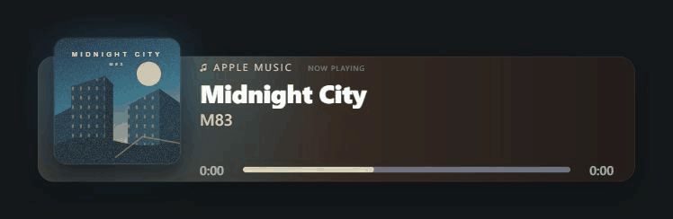

# Now Playing

在 Windows 本机运行，为 OBS 展示可自定义的正在播放组件。

目前支持 **Windows 官方 Apple Music 客户端**，无需额外播放器、浏览器扩展、开发者密钥或额外账户。

**简体中文** · [English](README.en.md)


## 功能

- **14 款皮肤**：简约卡片、透明排版、旋转唱片、专辑氛围光等。
- **每款皮肤都可切换真实频谱或进度条**，已播放和剩余部分使用独立颜色。
- **封面联动主题色**：生成与封面有区分度的柔和点缀色，也可自定义颜色、字体、尺寸和组件显示。
- **快速切歌动效**：歌名短距离滑动、模糊淡出淡入，长标题支持滚动。
- **独立 OBS 场景**：稳定的组件链接，自动保存，支持配置导入导出。
- **本机运行**：歌曲信息与音频分析留在电脑上，服务仅监听 `127.0.0.1`。

## 效果预览

歌名切换约 230 毫秒，位移最多 16 像素，限制在标题区域内。



<details>
<summary><strong>展开查看全部 14 款皮肤</strong></summary>


Default · Experimental · Aurora · Prism · Pulse · Pulse Progress · Rotating · Rotating Dark · Modern · Modern V2 · Transparent · Aiden Wallis Redesign · Rainbow · Aiden Wallis

</details>

截图使用项目内置的演示封面。演示预览中的频谱为模拟动画，实时歌曲预览与 OBS 使用实际音频采集。

## 快速开始

### 环境要求

- 已安装官方 Apple Music 客户端的 Windows，**推荐 Windows 11**。
- **Node.js 18+**，OBS Studio 与播放器运行在同一台电脑。
- 仅采集 Apple Music 音频需要 Windows **Build 20348+**；也可选择默认输出设备的全部声音。

### 启动

下载仓库，或克隆后启动本地服务：

```powershell
git clone https://github.com/modcrafts/now-playing.git
cd now-playing
node server.mjs
```

也可以直接双击 **`start.cmd`**。项目没有 npm 第三方依赖，无需执行 `npm install`。

### 添加到 OBS

1. 在 Apple Music 播放歌曲，打开[本地工作台](http://127.0.0.1:3963)。
2. 选择皮肤并调整外观，工作台目前使用简体中文。
3. 点击 **复制 OBS 组件链接**。
4. 在 OBS 新增 **浏览器来源**，粘贴链接，按工作台提示设置宽度和高度。

直播期间保持服务运行，工作台网页可以关闭。在服务窗口按 `Ctrl+C` 停止。

> 组件只提供画面。音乐声音请通过 OBS 的音频来源单独采集。

## 自定义

| 设置 | 用途 |
| --- | --- |
| 显示方式 | 跟随皮肤默认、实时音频频谱、普通进度条或关闭。 |
| 主题色跟随封面 | 根据当前封面生成有区分度的柔和点缀色。 |
| 音频来源 | 仅 Apple Music、默认输出设备的全部声音或关闭。 |
| 场景配置 | 为不同 OBS 场景保存独立样式和浏览器来源链接。 |
| 动态效果 | 控制组件动画，包括歌名切换动效。 |

打开[皮肤总览](http://127.0.0.1:3963/skins.html)可以比较全部设计。设置与封面缓存保存在 `.runtime/`，不会提交到 Git。

## 常见问题

- **没有歌曲信息**：先在官方 Apple Music 开始播放，再查看工作台的 **音乐连接** 页面。可读取的信息取决于客户端向 Windows 发布的内容。
- **没有频谱**：选择实时频谱模式，在预览中打开 **使用实时歌曲**，并检查音频来源和信号状态。不支持采集或音频静音时，不会用模拟动画替代真实频谱。
- **OBS 没有显示更新**：更新代码后重启服务，并刷新 OBS 浏览器来源。组件被裁切时，使用工作台推荐的画布尺寸。

暂不支持歌词和 Apple Music 动态封面。

## 开发

使用原生 JavaScript、Node.js、PowerShell 和 C#。运行 `node --test` 验证项目；采集链路与诊断方法见[开发说明](docs/DEVELOPMENT.md)。

视觉参考：[nowplaying.site](https://nowplaying.site/#features)。本项目的皮肤为独立实现。
